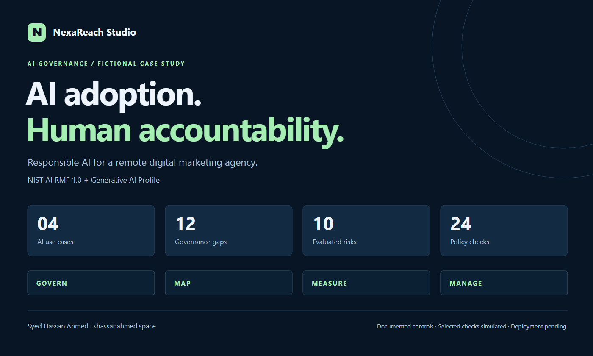

# NexaReach Studio | AI Governance Case Study

**A fictional remote marketing agency. Four AI use cases. One evidence-led governance project.**



**[Open the visual case study](index.html)** · **[Read the four-page brief](NexaReach_AI_Governance_Brief.pdf)** · **[Explore the risk register](data/risk-register.csv)**

> Portfolio simulation by [Syed Hassan Ahmed](https://shassanahmed.space/). Company details and baseline observations are invented. Governance artifacts and local simulation results are real project outputs; production enforcement and risk reduction have not been verified.

## The business problem

NexaReach is an invented digital marketing agency with **32 remote employees, 8 freelancers and 18 clients**, operating across Pakistan, the UK and the US. It uses AI to draft campaigns, summarize leads, answer FAQs and prepare workflow tasks. Client data, distributed access and public-facing outputs make informal AI adoption risky.

**Objective:** enable useful AI work with clear ownership, restricted inputs, human approval and a safe way to stop automation.

## Assessment at a glance

| Scope | Result |
| --- | --- |
| AI systems | 4 inventoried use cases |
| Governance gaps | 12: 8 missing and 4 partial in the assumed baseline |
| Risk evaluation | 10 scenarios; 7 initially High or Critical |
| Implementation | 12 control designs; selected policy logic simulated locally |
| Risk status | All 10 open; target residual ratings remain unvalidated |

## Framework implementation

This project uses **NIST AI RMF 1.0** and the **Generative AI Profile (NIST AI 600-1)**. NIST still lists 1.0 and says revisions are underway (checked 17 November 2026); this project does not invent an AI RMF 2.0 release. NIST CSF 2.0 is a separate framework. Mappings are selective and do not claim complete framework coverage or certification.

| Function | Project output |
| --- | --- |
| GOVERN | AI charter, tool approval, training, supplier criteria and escalation authority. [Artifact](docs/governance.md) |
| MAP | Four-system inventory, intended limits, input routes, affected groups and harm scenarios. [Artifact](data/ai-inventory.csv) |
| MEASURE | Risk scoring, repeatable policy checks, release criteria and a monitoring specification. [Artifact](evidence/control-checks.json) |
| MANAGE | Prioritized owners and deadlines, risk acceptance rules, AI incident response and retirement. [Artifact](docs/implementation.md) |

## Key decisions

- No raw customer lists, secrets or sensitive personal data in the scoped AI workflows.
- AI may draft. An independent reviewer must approve the exact public output revision.
- AI connectors cannot make payments, change ad spend or send autonomous outreach.
- Staff use approved work accounts with scoped access; personal AI tools require review.
- Any confirmed data exposure or critical false claim pauses the affected workflow.

## Reproduce the control evidence

Requires Node.js 18 or later. No packages, API keys, model calls or network access are needed.

```bash
node simulation/run.mjs
node scripts/validate.mjs
```

The first command regenerates a dated JSON report and sanitized local decision log from synthetic cases. It checks metadata-based policy decisions, including stale/self approvals and unsafe actions. It **does not detect PII, deepfakes, prompt injection, truthfulness or bias**. Caller-supplied metadata and identities are trusted simulation inputs; no production authentication or enforcement is provided.

## Files for reviewers

| File | Purpose |
| --- | --- |
| [index.html](index.html) | Responsive visual case study; works offline |
| [docs/assessment.md](docs/assessment.md) | Company assumptions, baseline workpapers and risk method |
| [docs/governance.md](docs/governance.md) | AI charter, acceptable use, ownership and approval rules |
| [docs/implementation.md](docs/implementation.md) | Control evidence, metrics, 90-day rollout and incident playbook |
| [data/](data/) | Editable AI inventory, gaps, risks and mappings as CSV/JSON |
| [evidence/](evidence/) | Generated local results and clearly labeled synthetic workpapers |
| [PORTFOLIO.md](PORTFOLIO.md) | Ready-to-use portfolio copy and GitHub publishing steps |

## Boundaries

No real company was assessed or deployed. No client data, independent audit, supplier contract, identity platform or live model was tested. The baseline is assumed, and residual ratings are forecasts conditional on controls working. Legal applicability needs a fact-specific review of processing, customers and jurisdictions. This case study does not establish legal compliance.

## Primary sources

- [NIST AI RMF overview / version status](https://www.nist.gov/itl/ai-risk-management-framework)
- [NIST AI 100-1: AI RMF 1.0 (2023)](https://doi.org/10.6028/NIST.AI.100-1)
- [NIST AI 600-1: Generative AI Profile (2024)](https://doi.org/10.6028/NIST.AI.600-1)

Project version 1.0 · 17 November 2026 · [MIT license](LICENSE)
